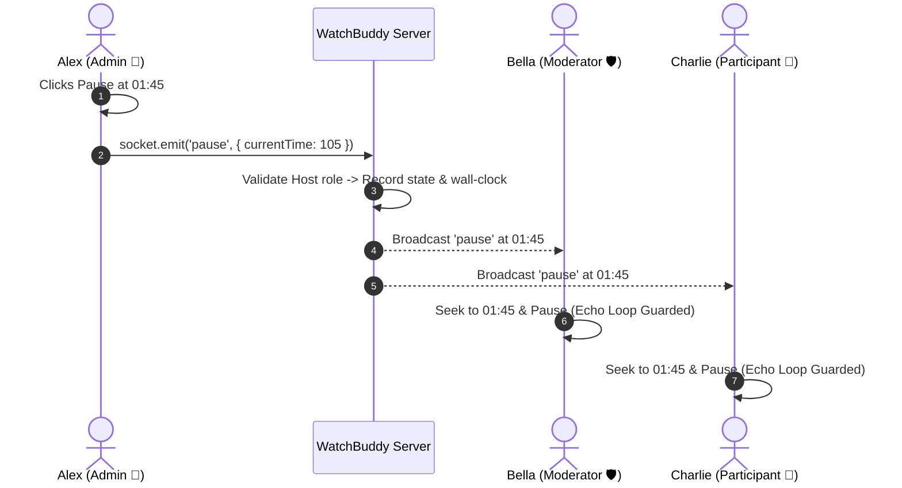

# 🍿 WatchBuddy — Real-Time YouTube Watch Party System

> **Full-Stack YouTube Watch Party System with Authentic YouTube Dark UI**  
> Built with **React 18 (Vite + Tailwind CSS)** on the frontend and **Node.js (Express + Socket.IO)** on the backend. Designed for sub-second playback synchronization, role-based access control (RBAC), conflict resolution, dynamic viral video discovery, friends management, session history, and zero-configuration deployment to **Netlify** and **Render**.

---

## 🌐 Live Deployments & Endpoints

- **Frontend (Netlify Live App)**: [https://watch-buddy.netlify.app](https://watch-buddy.netlify.app) *(Configured with `netlify.toml` and `_redirects`)*
- **Backend (Render WebSocket Service)**: [https://watchbuddy-server.onrender.com](https://watchbuddy-server.onrender.com) *(Node.js WebSocket Web Service)*
- **Health Check Endpoint**: [https://watchbuddy-server.onrender.com/health](https://watchbuddy-server.onrender.com/health)

---

## 📋 Table of Contents
1. [Core Features & Architecture](#-core-features--architecture)
2. [YouTube Dark UI & Design System](#-youtube-dark-ui--design-system)
3. [Host Departure Restrictions & Room Invariants](#-host-departure-restrictions--room-invariants)
4. [Mobile Optimization & Playback Resilience](#-mobile-optimization--playback-resilience)
5. [Explore Page & Randomized Viral Video Engine](#-explore-page--randomized-viral-video-engine)
6. [Watch Parties & Dedicated Friends Section](#-watch-parties--dedicated-friends-section)
7. [Watch Party History & Shared Room History](#-watch-party-history--shared-room-history)
8. [Playback Synchronization & Conflict Resolution Rules](#-playback-synchronization--conflict-resolution-rules)
9. [Tech Stack & Architecture](#-tech-stack--architecture)
10. [WebSocket Event Protocol](#-websocket-event-protocol)
11. [Local Development Setup](#-local-development-setup)
12. [Production Deployment Guide (Render + Netlify)](#-production-deployment-guide-render--netlify)
13. [Technical Interview & System Design Q&A](#-technical-interview--system-design-qa)

---

## 🎯 Core Features & Architecture

1. **Sub-Second Real-Time Playback Synchronization**:
   - Play, pause, seek, and video changes execute in lockstep across all connected viewers.
   - Intelligent wall-clock drift compensation with a 3.0-second tolerance window and **anti-echo loop protection**.
2. **Strict Host Departure Restriction & Room Invariant**:
   - **A watch party strictly cannot exist without a Host.**
   - When a Host attempts to leave a party with active participants, an interactive **Host Departure Modal** intercepts the exit, giving the Host two explicit options: **"Transfer Host & Leave"** (select a successor from active members) or **"End Party for Everyone"** (terminates room and safely ejects all attendees).
   - Abrupt Host disconnects with expired grace periods trigger an automatic room termination broadcast (`room_ended`).
3. **Mobile-Optimized Responsive Player & Autoplay Resilience**:
   - Zero blank/black video screens on mobile viewports with native `playsinline: 1` and responsive CSS 16:9 framing.
   - Smart 800ms autoplay block detection prompting a smooth **"Tap to Watch & Listen"** overlay to unlock mobile audio policies without breaking video sync.
   - High-resolution poster fallbacks and `referrerPolicy="no-referrer"` image delivery preventing 403 thumbnail errors.
4. **Authentic YouTube Dark Experience**:
   - Complete redesign inspired by YouTube desktop & mobile dark theme (`#0F0F0F`, `#181818`, `#212121`, `#303030`, `#FF0033`). Zero generic purple SaaS gradients.
5. **Dynamic Viral Video Discovery (Explore)**:
   - Full YouTube category list with an unpredictable Fisher-Yates randomization engine and instant shuffle.
6. **Watch Parties & Dedicated Friends Section**:
   - Social hub tracking friend online/in-room status with 1-click room joining and "+ Add Friend" modal.
7. **Detailed Session & Shared Video History**:
   - Comprehensive party session logs capturing who was **Admin / Host**, **Moderators**, **Participants**, and the timeline of watched videos.
8. **Role-Based Access Control (RBAC)**:
   - Three distinct roles: **Host** (supreme authority), **Moderator** (playback control), and **Participant** (viewer with suggestion privileges).
9. **Participant Suggestion Workflow**:
   - Viewers can suggest videos or actions; Hosts and Moderators receive non-intrusive approval banners.

---

## 🎨 YouTube Dark UI & Design System

WatchBuddy strictly follows YouTube's dark theme design language:

- **Color Tokens**:
  - `Background`: `#0F0F0F` (True dark background)
  - `Surface Primary`: `#181818` (Cards and panels)
  - `Surface Secondary`: `#212121` (Hover states & inputs)
  - `Borders & Dividers`: `#303030`
  - `Accent Red`: `#FF0033` (YouTube primary action red)
  - `Moderator Accent`: `#3EA6FF` (Moderator badges & highlights)
  - `Connected Green`: `#2BAE66` (Live socket indicator)
  - `Text Hierarchy`: Primary `#F1F1F1`, Secondary `#AAAAAA`, Muted `#717171`
- **Collapsible YouTube Navigation**:
  - **Desktop**: 230px expanded sidebar $\leftrightarrow$ 72px compact sidebar with toggle button.
  - **Mobile**: Responsive slide-out drawer with backdrop blur.
- **Top Navigation Bar (`h-14`)**:
  - WatchBuddy play badge logo (1-click return to active party/home without refresh).
  - Search bar supporting direct YouTube URL parsing (`youtube.com/watch?v=...`, `youtu.be/...`) and 11-character video IDs.
  - Live WebSocket connection indicator (🟢 Connected / 🟡 Reconnecting / 🔴 Disconnected).
- **Floating Sticky Room Banner**:
  - When in an active room, users can browse Explore, Friends, or History without disconnecting. A sleek top banner allows 1-click return to the synchronized video.

---

## 👑 Host Departure Restrictions & Room Invariants

WatchBuddy enforces a strict architectural invariant: **A Watch Party cannot exist without a Host.**

Automatic promotions on host departure have been replaced with explicit host authority transfer or graceful room termination:

### 1. The Host Leave Modal (`HostLeaveModal.jsx`)
When a Host clicks **"Leave"** while other participants or moderators are still in the party:
- Departure is immediately intercepted by the **Host Departure Modal**.
- The Host is presented with two explicit choices:
  - **Option 1: "Transfer Host & Leave"**:
    - Displays a live list of current room members with their role badges (🛡️ Moderator, 👤 Participant).
    - Host picks a successor and clicks *Transfer Host & Leave*.
    - The server promotes the selected member to **Host 👑**, demotes the departing host, and allows them to exit cleanly while playback continues uninterrupted for the party.
  - **Option 2: "End Party for Everyone"**:
    - Destructive one-click action that terminates the watch party.
    - All connected sockets receive the `room_ended` event and are automatically ejected back to the discovery screen with a clear notification: *"The Host ended the watch party."*
- **Cancel & Stay**: The Host can dismiss the modal at any time to remain in the party.

### 2. Disconnect & Network Drop Grace Period
- If a Host abruptly closes their tab or loses internet connection, the server initiates a **15-second grace period** (`scheduleDisconnect`).
- If the Host reconnects within 15 seconds, their session and Host privileges are seamlessly restored (`reconnect_room`).
- If the 15-second grace period expires without the Host reconnecting, the server marks `hostDeparted: true`, purges the room from memory, broadcasts `room_ended`, and cleans up all lingering sockets.

### 3. Lone Host Departure
- If a Host is the **only person** in the watch party (`participants.length <= 1`), clicking "Leave" exits immediately without a confirmation modal, and the empty room is safely garbage-collected.

---

## 📱 Mobile Optimization & Playback Resilience

To guarantee a native YouTube app feel on iOS Safari and Android Chrome, WatchBuddy implements targeted mobile optimizations:

1. **Inline Video Playback (`playsinline: 1`)**:
   - Standard mobile WebKit browsers force external iframes into fullscreen or show a black placeholder. WatchBuddy configures `playsinline: 1` alongside responsive 16:9 `.video-responsive-wrapper` CSS so the video plays natively within the chat/control layout.
2. **Mobile Autoplay Policy Handling**:
   - Modern mobile operating systems strictly prohibit unmuted autoplay without prior direct user interaction.
   - If an unmuted room video is blocked from playing automatically upon joining on mobile, an 800ms heartbeat detects the paused/blocked state and renders an elegant, touch-friendly **"Tap to Watch & Listen"** overlay. A single tap safely unlocks the browser's audio/video context and syncs to the room timestamp.
3. **High-Res Poster Backdrop**:
   - While the external YouTube IFrame initializes, an immediate high-resolution poster (`i.ytimg.com/vi/${id}/hqdefault.jpg`) renders behind the player, eliminating jarring black loading frames.
4. **Hotlink Defense & Referrer Policy**:
   - Thumbnail images specify `referrerPolicy="no-referrer"` to prevent 403 Forbidden responses when hotlinking YouTube video thumbnails on production Netlify domains.

---

## 🧭 Explore Page & Randomized Viral Video Engine

WatchBuddy features an authentic Explore portal matching YouTube's category structure:

- **Categories**:
  - 🎵 **Music**
  - 🎬 **Movies & TV**
  - 📡 **Live**
  - 🎮 **Gaming**
  - 🎙️ **Podcasts**
  - 🎲 **Playables**
  - ⭐ **Memberships**
  - 🔼 / 🔽 **Show fewer / Show more** expandable accordion toggle
- **Non-Predictable Fisher-Yates Randomization Engine (`viralVideoEngine.js`)**:
  - High-resolution viral video recommendations are dynamically shuffled on every page load, category change, or when clicking the **"🎲 Shuffle"** button.
  - Generates unpredictable, fresh viral videos while strictly matching the active category filter.
  - 16:9 thumbnail cards with duration badges, channel avatars, view counts, upload dates, "Copy Link", and a 1-click **"Watch with Friends"** party launcher.

---

## 👥 Watch Parties & Dedicated Friends Section

The **Watch Parties** page connects users to public parties and their friend circle:

1. **Dedicated Friends Section (`watchbuddy_friends`)**:
   - Live friend cards featuring avatars and real-time status indicators:
     - 🔴 **In Watch Party**: Displays the active room code & video with a 1-click **"Join Friend's Room"** action.
     - 🟢 **Online - Idle**: Includes an **"Invite to Party"** button that copies your room's direct link.
     - ⚪ **Offline**: Displays relative last-seen timestamps.
   - **"+ Add Friend" Modal**: Immediately adds friends with custom display names and handles, persisted in `localStorage`.
2. **Active Public Watch Parties**:
   - Community rooms (`#LOFI-CHILL`, `#ROCK-CLASSICS`, `#GTA6-WATCH`, etc.) displaying video thumbnails, host badges, live attendee counts, and instant join buttons.

---

## 📜 Watch Party History & Shared Room History

WatchBuddy maintains an automatic audit log of all watch party activities (`watchbuddy_room_history`):

1. **Tab 1: Watch Party Sessions**:
   - Card per party session detailing:
     - **Room Code**: e.g., `#HELL0168`, `#LOFI-NIGHT` with 1-click copy.
     - **Date & Time**: Relative timestamps (`Today, 1:45 PM`, `Yesterday`).
     - 👑 **Admin / Host**: Identifies the room creator.
     - 🛡️ **Moderator(s)**: Lists assigned moderators.
     - 👥 **Participants**: Complete attendee list of who was in the party.
     - **Watched Videos Timeline**: Chronological list of videos played during that party, with thumbnail, title, channel, duration, and a 1-click **"Re-watch Session"** button.
2. **Tab 2: Shared Video History**:
   - Complete archive of all individual videos watched across any party room.
   - 1-click **"Watch in New Party"** button to spin up a new party with that video.
3. **Automatic Recording**:
   - Every room creation, join, and video change is automatically recorded in real-time.

---

## ⚡ Playback Synchronization & Conflict Resolution Rules

WatchBuddy uses an authoritative server architecture with multi-layer conflict protection:

### The 3 Example Users
- **Alex (Admin / Host 👑)**: Room creator with supreme authority.
- **Bella (Moderator 🛡️)**: Elevated user with playback control privileges.
- **Charlie (Participant 👤)**: Regular viewer synchronized to the room.



### Scenario 1: Admin (Alex 👑) Interacts with Player
- **Execution**: Alex pauses, plays, or seeks. The server confirms `canControlPlayback('Host') === true`, updates the authoritative room state, and broadcasts the event.
- **Echo Loop Prevention**: When Bella and Charlie's YouTube players receive the command, an internal flag `isRemoteSyncRef = true` arms. When the player triggers its native `onStateChange` event, it disarms the flag and skips echoing back to the server, preventing infinite pause loops.
- **Video Change**: When Alex enters a new URL or selects a video, the server resets playback to `0:00`, pauses, loads the new video ID on all clients, and announces the change via a toast notification.

### Scenario 2: Moderator (Bella 🛡️) Interacts with Player
- **Execution**: Bella clicks Play, Pause, or drags the timeline. The server confirms `canControlPlayback('Moderator') === true`, updates the room state, and broadcasts it to everyone, including Alex and Charlie.
- **Simultaneous Conflict Resolution (Race Condition)**:
  - If Alex clicks "Play" and Bella clicks "Pause" at the exact same millisecond, Node.js processes the socket events sequentially on its event loop.
  - Whichever event reaches the server last becomes the **authoritative room state**. The server broadcasts this state, guaranteeing zero desync or split states.
- **Permission Boundary**: Bella cannot kick users, demote Alex, or transfer host ownership. Such attempts are blocked on the server (`canAssignRoles('Moderator') === false`).

### Scenario 3: Participant (Charlie 👤) Interacts
Participants are governed by a 3-tier protection system:
1. **Tier 1: UI Locking**: Play, Pause, -10s, +10s, and the scrubber are disabled with a padlock tooltip: *"Playback synchronized by Host"*. Charlie sees a **"Suggest Action"** button.
2. **Tier 2: IFrame Click Defense**: If Charlie clicks inside the native YouTube embed, `VideoPlayer.jsx` checks `if (!canControl) return;` and refuses to send any socket event. Alex and Bella's playback continues undisturbed.
3. **Tier 3: Automatic Snap-Back (Drift Engine)**: If Charlie paused locally, his player will drift behind. Every 4 seconds, Charlie's client checks drift against the server's expected time:
   $$\text{Expected Time} = \text{Server Time} + (\text{Current Time} - \text{Last Updated})$$
   If drift exceeds **3.0 seconds**, Charlie's player automatically seeks forward to match Alex and Bella.
4. **Tier 4: Server Security**: If Charlie bypasses the UI and emits raw socket events, the server drops the request and replies with an unauthorized error.
5. **Suggestion Flow**: Charlie clicks "Suggest Action", submitting a video URL. Alex and Bella receive a review modal to **Approve** or **Decline**.

### Summary Matrix

| Capability | Alex (Admin 👑) | Bella (Moderator 🛡️) | Charlie (Participant 👤) |
| :--- | :---: | :---: | :---: |
| **Play / Pause / Seek** | ✅ Allowed | ✅ Allowed | ❌ Blocked (auto-snaps back) |
| **Change Video** | ✅ Allowed | ✅ Allowed | 🔄 Suggestion only |
| **Approve / Decline Suggestions** | ✅ Allowed | ✅ Allowed | ❌ Blocked |
| **Promote / Demote Roles** | ✅ Allowed | ❌ Blocked | ❌ Blocked |
| **Kick Participant** | ✅ Allowed | ❌ Blocked | ❌ Blocked |
| **Transfer Host Authority** | ✅ Allowed | ❌ Blocked | ❌ Blocked |

---

## 🛠️ Tech Stack & Architecture

| Layer | Technology | Purpose & Justification |
| :--- | :--- | :--- |
| **Frontend Framework** | **React 18 + Vite** | High-performance SPA with instant Hot Module Replacement (HMR). No SSR hydration mismatches with YouTube IFrame. |
| **Styling & Icons** | **Tailwind CSS + Lucide Icons** | Pixel-accurate YouTube Dark design tokens with lightweight SVG icons. |
| **Backend Runtime** | **Node.js + Express** | Lightweight HTTP server with permissive CORS and `/health` monitoring. |
| **Real-Time Engine** | **Socket.IO 4.8** | Low-latency WebSockets with room isolation (`socket.join`), auto-reconnection, and polling fallback. |
| **State & Store** | **In-Memory OOP Store** | Encapsulated classes (`Room`, `Participant`, `RoomManager`) with $O(1)$ Map lookups and strict host departure lifecycle enforcement. |
| **Video Engine** | **YouTube IFrame Player API** | Authoritative programmatic video control (`playVideo`, `pauseVideo`, `seekTo`, `loadVideoById`). |
| **Frontend Host** | **Netlify** | Fast global CDN with client-side SPA redirect routing via `netlify.toml` and `_redirects`. |
| **Backend Host** | **Render** | Free persistent Web Service with native WebSockets support and automatic HTTPS. |

---

## 📡 WebSocket Event Protocol

| Event Name | Direction | Payload | Role Required | Description |
| :--- | :--- | :--- | :--- | :--- |
| `create_room` | Client $\rightarrow$ Server | `{ username, customRoomId?, initialVideoId? }` | Anyone | Creates a room; creator becomes Host with selected initial video. |
| `join_room` | Client $\rightarrow$ Server | `{ roomId, username }` | Anyone | Joins room (Host if creator, else Participant). |
| `leave_room` | Client $\rightarrow$ Server | `{}` | Room Member | Leaves room. If Host departs without transferring ownership, party terminates for everyone. |
| `end_room` | Client $\rightarrow$ Server | `{}` | Host Only | Explicitly terminates the watch party and disconnects all members. |
| `room_ended` | Server $\rightarrow$ Clients | `{ message, roomId }` | Broadcast | Broadcast when room terminates (host left or ended party). |
| `sync_state` | Server $\rightarrow$ Client | `{ videoId, playState, currentTime }` | Server | Authoritative state sent upon joining or reconnecting. |
| `play` | Client $\rightarrow$ Server | `{ currentTime }` | Host / Mod | Requests room playback resume at given timestamp. |
| `pause` | Client $\rightarrow$ Server | `{ currentTime }` | Host / Mod | Requests room playback pause at given timestamp. |
| `seek` | Client $\rightarrow$ Server | `{ time }` | Host / Mod | Seeks playback to given timestamp for all members. |
| `change_video` | Client $\rightarrow$ Server | `{ videoId }` | Host / Mod | Unloads current video and loads new video ID at 0:00. |
| `assign_role` | Client $\rightarrow$ Server | `{ targetUserId, role }` | Host Only | Promotes or demotes participant (`Moderator` / `Participant`). |
| `remove_participant`| Client $\rightarrow$ Server| `{ targetUserId }` | Host Only | Kicks target participant from the room. |
| `participant_removed`| Server $\rightarrow$ Clients| `{ userId, participants, message }` | Broadcast | Notifies client and room that user was removed. |
| `transfer_host` | Client $\rightarrow$ Server | `{ targetUserId }` | Host Only | Transfers room host ownership to target participant. |
| `request_change` | Client $\rightarrow$ Server | `{ type, details }` | Participant | Submits video or playback suggestion for review. |
| `approve_change` | Client $\rightarrow$ Server | `{ requestId, approved }` | Host / Mod | Approves or declines participant suggestion. |
| `send_chat` | Client $\rightarrow$ Server | `{ message }` | Room Member | Broadcasts text chat message to room members. |
| `user_joined` | Server $\rightarrow$ Clients | `{ user, userId, username, role, participants }` | Broadcast | Notifies room of new member arrival. |
| `user_left` | Server $\rightarrow$ Clients | `{ userId, username, newHost?, participants }` | Broadcast | Notifies room of member departure. |
| `role_assigned` | Server $\rightarrow$ Clients | `{ userId, role, participants }` | Broadcast | Notifies room of updated role privileges. |

---

## 💻 Local Development Setup

### Prerequisites
- Node.js (v18 or higher)
- npm (v9 or higher)

### 1. Clone & Install
```bash
git clone <your-repo-url>
cd "Watch Buddy"

# Install server dependencies
cd server
npm install

# Install client dependencies
cd ../client
npm install
```

### 2. Start Backend Server
```bash
cd server
npm start
# Server runs at http://localhost:5000
# Health check available at http://localhost:5000/health
```

### 3. Start Frontend Client
In a second terminal window:
```bash
cd client
npm run dev
# Vite runs at http://localhost:5173
```

### 4. Run Test Suite
```bash
cd server
npm test
# Runs unit tests and multi-client Socket.IO integration tests
```

---

## 🚀 Production Deployment Guide (Render + Netlify)

### Part 1: Deploy Backend to Render
1. Push your repository to [GitHub](https://github.com).
2. Go to [dashboard.render.com](https://dashboard.render.com/) $\rightarrow$ **New +** $\rightarrow$ **Web Service**.
3. Select your `watchbuddy` repository.
4. Set configuration:
   - **Root Directory**: `server`
   - **Runtime**: `Node`
   - **Build Command**: `npm install`
   - **Start Command**: `npm start`
   - **Plan**: `Free`
   - **Health Check Path**: `/health` (Under Advanced)
5. Deploy and copy your Render URL: `https://watchbuddy-server.onrender.com`.

### Part 2: Deploy Frontend to Netlify
1. Go to [app.netlify.com](https://app.netlify.com/) $\rightarrow$ **Add new site** $\rightarrow$ **Import an existing project**.
2. Select your `watchbuddy` repository.
3. Netlify will auto-detect settings from [netlify.toml](file:///c:/Users/husai/Desktop/Watch%20Buddy/netlify.toml):
   - **Base directory**: `client`
   - **Build command**: `npm run build`
   - **Publish directory**: `dist`
4. Add the Environment Variable:
   - **Key**: `VITE_BACKEND_URL`
   - **Value**: `https://watchbuddy-server.onrender.com` *(Your Render backend URL)*
5. Deploy site. Your app will be live at `https://watch-buddy.netlify.app`.

---

## 🎤 Technical Interview & System Design Q&A

### 1. How does WatchBuddy handle race conditions when two users interact simultaneously?
> *"Network events are handled by the Node.js single-threaded event loop sequentially. Whichever event arrives at the server socket last becomes the official authoritative room state. The server assigns a wall-clock timestamp and broadcasts this state. All clients immediately synchronize to that final state, preventing state divergence."*

### 2. How do you prevent infinite pause/seek echo loops?
> *"When a client receives a WebSocket sync command and invokes `player.pauseVideo()`, the YouTube iframe API automatically fires an internal `onStateChange` event. If unhandled, this would cause the client to emit another pause event back to the server, creating an infinite storm. We prevent this by arming an `isRemoteSyncRef` boolean flag during remote updates. When the player event fires, it checks the flag, disarms it, and skips echoing back to the server."*

### 3. How does playback drift compensation work for lagged viewers?
> *"Different users have different network latencies. Small differences (under 3.0 seconds) are intentionally ignored so playback doesn't micro-stutter. Every 4 seconds, clients evaluate their local time against `expectedTime = serverTime + (now - lastUpdated)`. If a viewer experiences buffering or tabs out and drifts more than 3.0 seconds behind, the client smoothly seeks forward to the exact position of the host."*

### 4. Why Vite + React over Next.js for this project?
> *"Watch party applications rely 100% on client-side state: browser WebSockets, DOM iframe manipulation, and real-time canvas interactions. Next.js SSR adds hydration mismatch complexities when dealing with external iframes and introduces unnecessary server runtime costs. React + Vite compiles into pure static assets deployed globally on Netlify CDN for free, communicating directly with our persistent WebSocket server on Render."*

### 5. Why enforce a strict Host Departure Restriction rather than blindly promoting a remaining participant?
> *"In real-time collaboration systems, room ownership represents administrative accountability. Blindly auto-promoting arbitrary attendees when a creator leaves leads to 'zombie rooms' and unexpected privilege elevation. By enforcing the invariant that a watch party cannot exist without a Host, WatchBuddy empowers the room creator with explicit agency: they can deliberately designate a vetted successor via 'Transfer Host & Leave', or cleanly disband the session for everyone via 'End Party for Everyone'."*

### 6. How does WatchBuddy handle mobile WebKit video playback and autoplay policy restrictions?
> *"Mobile operating systems (iOS Safari, Android Chrome) block unmuted programmatic autoplay without a direct user gesture, and default to launching external video streams into full-screen OS media players. WatchBuddy solves this by passing `playsinline: 1` to embed the player directly into the DOM layout, and attaches an 800ms touch-unblock handshake. If playback is blocked upon entering a party, an elegant 'Tap to Watch & Listen' overlay safely unlocks the browser's audio/video context without desynchronizing the playback timeline."*
